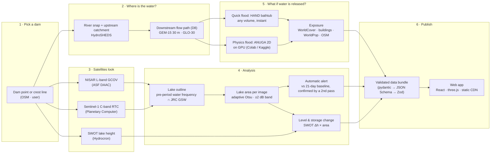

<p align="center">
  
</p>

<h3 align="center">Watching dams and the rivers below them from space, with NISAR and Sentinel-1</h3>

<p align="center">
  NASA Space Apps Challenge 2026 · Tunis · challenge <em>“Dancing with SARs”</em><br />
  <a href="https://dancingwithrivers.study"><strong>Live demo → dancingwithrivers.study</strong></a>
</p>

<p align="center">
  <a href="https://dancingwithrivers.study"></a>
  
  
  
  
  
  <a href="LICENSE"></a>
</p>

---

## The story

On the night of **17–18 June 2026**, a 72-year-old gate failed at Tunisia’s **Mellègue dam** and about **21 million m³** of water escaped (reported). The **NISAR** radar satellite watched the lake drain in the following weeks.

**Dancing with the Rivers** replays that night in 3D from real radar data, explains each radar signal in plain language, and then generalises the method: **pick a dam, and the same pipeline measures its lake from space, raises alerts, and maps where released water would go.** It is already running on four dams in two countries (Tunisia and Algeria).

| | What you see in the app |
|---|---|
| **Story (9 acts)** | The Mellègue failure, from the last radar image before it to the flood scenarios, every number with a badge: MEASURED · REPORTED · MODELLED · ILLUSTRATIVE |
| **Dam Watch** | One honest monitoring panel: lake area, automatic alert, SWOT water level, flood scenarios |
| **Methods** | An 11-step illustrated tutorial of the pipeline (simplified and advanced) and the 43 validation tests |
| **Dancing with your Dam** | The pipeline run on Mellègue, Sidi Salem, El Aroussia and Ouldjet Mellègue (Algeria), step by step, on real data |

## End-to-end pipeline



**Step by step**

1. **Pick a dam.** From a point or a crest line (OpenStreetMap or user-supplied), anywhere in the world.
2. **Geometry.** Snap to the river network, delineate the upstream catchment (HydroBASINS level 12), and trace the downstream path with D8 routing on a 30 m terrain model (GEM-15, Copernicus GLO-30 in gaps).
3. **Radar.** Read small windows of every NISAR GCOV and Sentinel-1 RTC image over the lake; read SWOT lake heights when the lake is in the SWOT database.
4. **Lake area.** Per-image adaptive (Otsu) threshold inside a radar-derived lake outline, harmonised per track, with a ±2 dB uncertainty band and wind flags.
5. **Alert.** Each new pass is compared with the 21-day multi-sensor median: WARNING below −12 %, ALERT below −20 %, each confirmed by an independent pass. For Mellègue it would have fired on **22 June 2026, five days after the failure, with no ground sensor** (NISAR + Sentinel-1 together).
6. **Floods.** HAND “bathtub” screening for any volume, and ANUGA 2D shallow-water runs (12 h release) on a GPU; exposure of cropland, buildings, roads and people. Scenarios, never forecasts.
7. **Publish.** Every output is validated against shared data contracts and served as a static, versioned bundle: no runtime API, no keys in the browser.

## Results so far

| Dam | Country | NISAR + Sentinel-1 looks | Lake area | Flood runs |
|---|---|---|---|---|
| Mellègue (the June 2026 event) | Tunisia | 41 + 92 | 2.9 → 1.6 km² drawdown | HAND + ANUGA 21 / 50 / 195 Mm³ |
| Sidi Salem | Tunisia | 22 + 111 | ~32 → 26 km² (seasonal) | HAND + ANUGA on GPU |
| El Aroussia (diversion dam) | Tunisia | 22 + 73 | 0.05–0.17 km² pool | HAND + ANUGA on GPU |
| Ouldjet Mellègue | Algeria | 21 + 81 | ~11 km², stable | HAND + ANUGA on GPU |

ANUGA flood runs took **1–6 min each on a free T4 GPU** (versus 1–4 h estimated on CPU). Honest limits are shown in the app: the alert rule was tuned on one event; flood timing is mesh-sensitive (shown as a range); exposure is not damage.

## Context and research

**Why Mellègue.** The Mellègue dam (built 1954) sits on the Oued Mellègue in north-west Tunisia, near the Algerian border. Its catchment covers **10,315 km²**, much of it in Algeria; its lake is about **80 % silted** (reported), and a much larger dam, **Upper Mellègue (195 Mm³)**, is being built upstream. Downstream, the river joins the **Medjerda**, Tunisia’s main river, and flows into the **Sidi Salem** reservoir.

**The event (reported, press).**

| When | What |
|---|---|
| 17 Jun 2026, ~21:15 | The upper sector gate fails during a planned 100,000 m³ irrigation release |
| 17–18 Jun | About **21 Mm³** released in a few hours (one outlet reports 29 Mm³); farmland damaged downstream |
| 21 Jun | The water reaches the Sidi Salem reservoir |
| 16 Jul | Gate repaired |

**What the satellites saw.** The last radar image before the failure is **Sentinel-1, 17 June, 17:20 UTC**. NISAR’s first image after it is **19 June**. No satellite imaged the failure itself. NISAR delivered **1,754 products over Tunisia** between 17 June and 31 October 2026, imaging Mellègue on **31 dates** from four tracks. Tunisia’s daily dam bulletins stopped in October 2025, which is why an independent view from space matters.

**What the data show.** The lake shrank gradually from about 2.9 km² before the failure to about **1.6 km²** in late July (a drawdown over weeks, not an overnight disappearance), stayed low in August, and rose again with the autumn rain. SWOT measured the lake surface falling **3.75 ± 0.08 m** between 7 and 28 June.

## From one dam to any dam

The Mellègue pilot taught us what must change for the method to work anywhere:

1. **A fixed water threshold does not transfer**, even between dates at one dam (wind at C-band, wet mud at L-band): thresholds are computed per image.
2. **Static reservoir outlines are wrong**: the lake outline comes from radar water frequency before the period of interest.
3. **Area alone lags after a release** (wet sediment looks like water at L-band); the radar brightness inside the lake reacts at once.
4. **Single-pair change tests are too noisy**: a rolling baseline with independent confirmation works.

**V2, built and tested.** One command (`pipeline/v2/run_dam.py`) runs the whole chain for any dam from a point or a crest line: river snap, catchment, flow path, NISAR + Sentinel-1 series, alert, SWOT, HAND table, ANUGA package. It ran unchanged on Sidi Salem, El Aroussia and the Ouldjet Mellègue dam in Algeria, and the ANUGA floods ran on a free GPU in minutes.

**Next: hosting.** Anyone picks a dam online; our servers queue the job (radar data take 16–30 min per dam, floods a few minutes on GPU) and publish the dam’s page, updated after every satellite pass, with alerts. Before any alert is called operational, the rule must be tested on many dams, out of sample.

## Repository

```
apps/web/          React + TypeScript app (Vite, three.js / R3F, Tailwind), static data bundles in public/data/
pipeline/          Python pipeline: 00–09 (Mellègue), v2/ (any dam: run_dam, route_hand, anuga_*)
contracts/         JSON Schemas generated from the pydantic data contracts
colab/             ANUGA GPU notebook for Google Colab and Kaggle
docker/            Web image (nginx) and ANUGA image
submission/        Project page, video script, deck
```

**Run locally**

```bash
docker compose up --build web          # → http://localhost:5173
# or
cd apps/web && pnpm install && pnpm dev
```

The pipeline needs Python 3.11 (`requirements.txt`) and an Earthdata token in a local `.env` for NISAR (never committed).

## Data and references

- **NISAR** L2 GCOV, NASA/JPL–ISRO, via the Alaska Satellite Facility DAAC (`asf_search`).
- **Sentinel-1** RTC, ESA Copernicus, via Microsoft Planetary Computer.
- **SWOT** LakeSP, NASA/CNES, via Hydrocron (PO.DAAC).
- **GEM-15** digital terrain model. This dataset is produced by Google. Batchu et al. (2026), EarthArXiv, doi:10.31223/X55N75 (CC-BY 4.0).
- **NASADEM** (NASA) and **Copernicus GLO-30** DEM (© DLR / Airbus).
- **HydroSHEDS**: HydroRIVERS and HydroBASINS. Lehner, B. & Grill, G. (2013), *Hydrological Processes* 27(15).
- **JRC Global Surface Water**. Pekel, J.-F. et al. (2016), *Nature* 540, 418–422.
- **ESA WorldCover** 2021 (CC-BY 4.0); **WorldPop** population; **Microsoft Global ML Building Footprints** (ODbL).
- **OpenStreetMap** contributors (ODbL); **geoBoundaries**.
- **ANUGA** hydrodynamic model, Geoscience Australia / Australian National University.
- Event facts (gate failure, released volume, repair date): Tunisian press, cited per fact in the app’s Sources page.

No NASA logos or branding are used. Satellite data remain the property of their providers under their licences.

## Use of AI

We used AI coding assistants (Claude Code with Claude Opus; Google Antigravity) to write parts of the data pipeline, the web app and the text. All numbers come from the pipeline outputs, checked by automated tests and a review of every claim. No data was generated by AI.

## Team

**Amine Kacem · Mohamed Jihed Fradi · Khaled Cheniour · Nour Ayadi · Yessmine Chaabouni · Sahar Feki**

NASA Space Apps Challenge 2026, Tunis.

## License

Code released under the [MIT License](LICENSE) © 2026 the team above. Third-party data keep their own licences (see *Data and references*).
