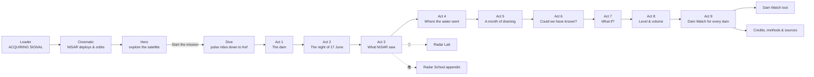
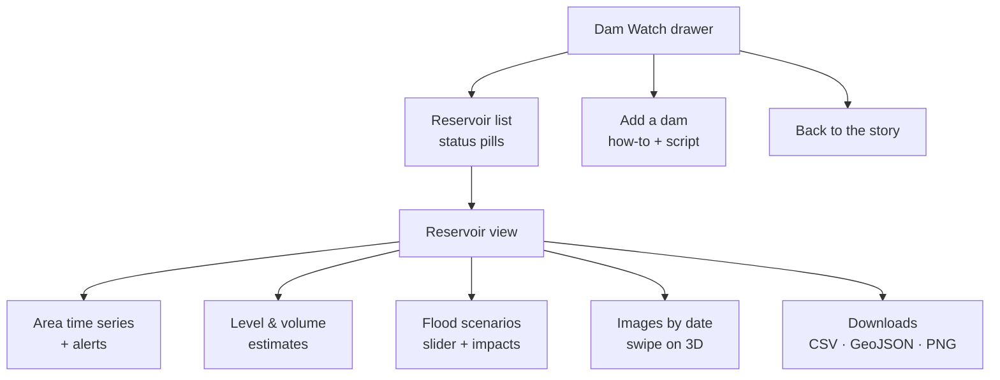

# 05 · App Flow

From the first frame to the Dam Watch tool, screen by screen. The flow is **linear and narrative by default** (scroll or ←/→), with free exploration always available (rail, scrubber, layers, Lab).

---

## 1. Intro (route `/`, prototype ported to React Three Fiber + GSAP)

The prototype HTML is the reference for timings, look and copy; the rebuilt `features/intro` reproduces it with the changes below.

| Step | What the user sees | Change vs the prototype |
|---|---|---|
| 1. Loader | "ACQUIRING SIGNAL" | Driven by drei `useProgress` + TanStack Query prefetch of `manifest.json`, the heightmap and the Act 1–3 textures |
| 2. Cinematic (chapters Approach 0 s, Deploy 3.4 s, Orbit 6.8 s, Scan 9.2 s; hero at 11.2 s) | NISAR approaches, deploys its 12 m reflector, orbits at 747 km, scans with L-band 24 cm | Caption 4 → "L-band, 24 cm. It sees through clouds, day and night." HUD **TARGET → 36.31°N 8.70°E · MELLÈGUE DAM**. Skip button kept |
| 3. Hero | Title HydroStress, the satellite to explore (hotspots, facts) | Subtitle → *"On the night of 17 June 2026, a dam gate failed in northwest Tunisia. NISAR was watching. Follow the water."* Primary button **Start the mission →**; secondary "Explore the satellite" |
| 4. Dive (GSAP timeline: fuse 2.5 s, flash 3.1 s, end 3.4 s) | The camera rides the radar pulse down toward Earth | Caption → **"Riding the pulse down to the Mellègue dam, Kef"**. At the end of the dive **do not open the Tunis journey**: `navigate('/story/1')`. The persistent `<Stage>` switches its scene from the satellite to the Mellègue terrain under the white flash and fades in at shot `arrival` |

Skipping: Esc or "Skip intro" goes straight to `/story/1` (for judges and repeat visits; remembered with `localStorage` in a try/catch). Any deep link (`/story/3?date=2026-07-01`) skips the intro automatically.

## 2. Arrival (transition to Act 1)

1. The white flash fades out over **the real 3D terrain** from a high SW oblique: hills of Kef, the reservoir glinting, the river thread to the NE.
2. HUD types out: `36.31°N 8.70°E · MELLÈGUE DAM · NISAR L-BAND · 2026-06-17`.
3. The topbar slides in (Act counter, progress, Everyone|Experts, Read aloud, Lab, Tour, Glossary, Sources).
4. The first card slides in from the left. A hint chip "Scroll or press → to continue" appears for 4 s.

## 3. The nine acts

Each act lists: **shot** (camera), **stage** (layers and date), **card** (Everyone text; Experts add-ons), **Try it**, **badges**, **data files**. Text is a draft; refine it with the real numbers.

### Act 1 · The dam  (P0)
- **Shot:** `arrival` → slow orbit to `dam_close`.
- **Stage:** optical basemap; dam marker; reservoir outline (max extent); river line faint.
- **Card:** *Kick:* ACT 1 · THE DAM. *Title:* "A 72-year-old guardian." *Body:* "Built in 1954 on the Mellègue river, near the Algerian border, this dam feeds the farms of Jendouba. Its lake is now about 80% full of mud. A new, much bigger dam just upstream, Upper Mellègue (195 million m³), was about to replace it."
- **Experts:** location, height, catchment, siltation sources; NISAR tracks covering it (D80, A101, A173, D8).
- **Try it:** [Fly around the dam] [Show the new dam site] [Show the downstream valley].
- **Badges:** REPORTED (history), MEASURED (terrain).

### Act 2 · The night of 17 June  (P0)
- **Shot:** `night_dam` (scene relit at night; moon light).
- **Stage:** at 18:20 the **Sentinel-1 17 Jun 17:20 UTC** image fades in over the lake ("the last look before"); a clock overlay runs 18:20 → 21:15; at 21:15 the gate icon turns red and a water pulse animates out of the dam.
- **Card:** *Title:* "21:15 — a gate gives way." *Body:* "A planned release of 100,000 m³ for irrigation turned into an uncontrolled flow when a gate failed. In a few hours about 21 million m³ left the lake, about 210 times what was planned. Farms downstream were flooded."
- **Experts:** reports range 21–29 Mm³ (sources); S1 image is orbit 88, VV/VH, about 3 h before the failure.
- **Try it:** [Replay the night] [See the last image before].
- **Badges:** REPORTED (time, volumes), MEASURED (S1 image).

### Act 3 · What NISAR saw  (P0)
- **Shot:** `lake_top` (nadir over the reservoir).
- **Stage:** **swipe**: left S1 17 Jun (before) | right NISAR **19 Jun** (D80). The scrubber unlocks: 19 Jun, 21 Jun, 1 Jul, 3 Jul, 13 Jul, 15 Jul. Water mask toggle.
- **Card:** *Title:* "Two days later, the lake had shrunk." *Body:* "On 19 June, 46 hours after the failure, NISAR passed over. Calm water reflects radar away like a mirror, so the lake looks black. Drag the slider: the black area is smaller, and by 1 July it has broken into pieces."
- **Radar lens:** mirror (specular) vs rough land; L-band 24 cm; HH polarisation.
- **Experts:** γ⁰ HH dB; threshold −18 dB; boxcar 5×5; noise 0.6–0.9 dB; GCOV product IDs.
- **Try it:** [Swipe before/after] [Play 19 Jun → 15 Jul] [🧪 Why is the lake black?] (opens the Radar Lab preset to "water", band L, roughness low) [Show the change map].
- **Badges:** MEASURED.

### Act 4 · Where the water went  (P0 path; P1 ANUGA replay)
- **Shot:** `valley_follow`: a camera spline along the flow path dam → Medjerda → Jendouba → Bou Salem → **Sidi Salem** (≈ 15 s), with distance labels.
- **Stage:** animated flow path; villages pins; ANUGA "June 2026 reconstruction" (21 Mm³, 12 h) depth frames playing along (P1); arrival at Sidi Salem flagged on **21 Jun** (reported).
- **Card:** *Title:* "Downhill, all the way to Sidi Salem." *Body:* "Water always takes the steepest way down. Following the terrain, the release travelled down the Mellègue into the Medjerda and reached Sidi Salem, the country's largest reservoir, about 4 days later. Sidi Salem absorbed it."
- **Experts:** D8 routing on NASADEM 30 m; path length; ANUGA set-up summary; why NISAR's faint wetter line along the channel is only a hint.
- **Try it:** [Follow the water] [Show villages] [Compare with radar: river channel 17 → 22 Jun].
- **Badges:** MODELLED (path, ANUGA), REPORTED (arrival date), MEASURED (radar hint).

### Act 5 · A month of draining  (P0)
- **Shot:** `lake_top`, then slow pull-back.
- **Stage:** the scrubber auto-plays all dates 17 Jun → 29 Oct (gap 25 Jul – 13 Aug shown as a hatched band). The chart card shows the area time series with events.
- **Card:** *Title:* "Every few days, a new look." *Body:* "Combining NISAR's tracks gives a new image of the lake every 2–7 days, through clouds, day or night. The lake stayed low until the gate was repaired on 16 July, then [TBD: recovered / kept falling with summer heat]."
- **Experts:** per-track series, offset normalisation, S1 cross-check, acquisitions table.
- **Try it:** [Click a point to see that day] [Show NISAR only / add Sentinel-1].
- **Badges:** MEASURED (area), REPORTED (events).

### Act 6 · Could we have known?  (P0)
- **Shot:** `lake_top` with an alert pulse ring on the reservoir.
- **Stage:** replay "as if live": the scrubber stops on 19 Jun; the **Alert card** animates in.
- **Card:** *Title:* "An automatic alarm, from space." *Body:* "We taught HydroStress what a normal summer looks like for this lake. When an image shows the lake shrinking much faster than normal, it raises an alert. On 19 June it would have fired, with no ground sensors and no one needing to report it."
- **Experts:** the rule (z-score on relative area change vs seasonal rate; ALERT if z < −3 and Δa < −15%), false-alarm test result, latency (NISAR product latency in hours to days; Urgent Response mode as future).
- **Try it:** [Why did it fire?] [Run the detector on all dates] (shows ✓/⚠ on each scrubber dot).
- **Badges:** MEASURED + MODELLED (detector).

### Act 7 · What if?  (P1, the "wow" interactive)
- **Shot:** `scenario_overview` (high oblique over the whole valley).
- **Stage:** HAND flood layer driven by the **volume slider**; impact counters; in Physics mode ANUGA max depth/arrival per scenario; villages light up when reached.
- **Card:** *Title:* "And if it had been more water?" *Body:* "Move the slider to release any volume from the dam. 21 million m³ is what happened in June. 195 million m³ is the full new Upper Mellègue dam upstream. See which farms, roads and villages the water could reach."
- **Experts:** HAND method and lookup; ANUGA scenario list (volume × duration), Manning's n, mesh; why the two modes differ.
- **Try it:** [21 Mm³ · June 2026] [50 Mm³] [195 Mm³ · Upper Mellègue full] [Quick ↔ Physics] [Who is warned first?].
- **Badges:** MODELLED, with a permanent banner *"Scenario exploration, not a forecast. 30 m terrain."*

### Act 8 · Level & volume  (P1)
- **Shot:** `lake_top` with a side "cut-away" section showing the bank slope.
- **Stage:** shoreline contours by date drawn on the DEM; optional SWOT dots on the scrubber.
- **Card:** *Title:* "From area to water level and volume." *Body:* "Radar shows how big the lake is. To know how much water it holds, we add SWOT, a NASA–CNES satellite that measures lake height, and the shape of the valley. Together they estimate how many million m³ left."
- **Level & volume card:** SWOT level (if any) ± σ · DEM-shoreline level ± σ · ΔV estimate vs reported 21 Mm³.
- **Try it:** [How we test this] → validation page (→ 07).
- **Badges:** MEASURED (SWOT), MODELLED (estimates), REPORTED (official).

### Act 9 · Dam Watch for every dam  (P1)
- **Shot:** `catchment_wide`, pull out to show other reservoirs (Sidi Salem, Bou Heurtma, Ben Métir… P2) with status pills.
- **Card:** *Title:* "One lake today. Every dam tomorrow." *Body:* "Tunisia's daily dam bulletins stopped in 2025. NISAR passes over every reservoir in the country every 12 days or less, for free. HydroStress turns that into an independent watch: area, alerts, level, and flood scenarios."
- **Try it:** **[Open Dam Watch →]** (unlocks the tool) · [Methods & validation] · [Sources] · [Replay the story].
- **Badges:** —

## 4. Dam Watch tool (post-story)

- The stage stays visible; selecting a date or scenario updates the 3D.
- "Add a dam": draw or upload a polygon (P2) → shows the CLI command `python pipeline/run_all.py --dam "<name>" --polygon lake.geojson`.

## 5. Global navigation & persistent controls

| Control | Behaviour |
|---|---|
| Rail (acts) | Jump to any act; completed acts filled |
| ←/→ keys, scroll | Previous/next act (one card = one act; long acts have sub-steps) |
| Everyone / Experts | Swaps card text and adds Experts panels; remembered |
| Read aloud | Reads the current card |
| Lab | Opens the Radar Lab (free play) |
| Tour | Guided auto-play of the whole story (≈ 3 min), pausable; used for the demo video |
| Glossary | Side sheet of terms (backscatter, polarisation, L-band, HAND, ANUGA, Mm³ …) |
| Sources ⓘ | All sources and data credits; per-act anchors |
| Scrubber | Visible from Act 3; disabled in Acts 1–2 (scripted time) |
| Layers | Visible from Act 3 |
| Back to intro | In the ☰ menu (replays the cinematic) |

## 6. Guided tour script (demo / video)

| t (s) | Action |
|---|---|
| 0 | Skip to the hero → click Start the mission (dive 3.4 s) |
| 4 | Act 1 arrival shot (3 s) |
| 7 | Act 2 night replay, accelerated (4 s) |
| 11 | Act 3 swipe S1 → NISAR 19 Jun → 1 Jul (4 s) |
| 15 | Act 4 follow the water (4 s) |
| 19 | Act 6 alert card appears (3 s) |
| 22 | Act 7 slider 21 → 195 Mm³, counters jump (5 s) |
| 27 | Act 9 "Every dam tomorrow" + logo (3 s) |

That is the **30 s video**. The full tour (≈ 3 min) plays the same with all cards.

## 7. Radar School (appendix, reuse of the old journey)

The existing stylized Greater-Tunis content (Three surfaces Water/Land/City, Radar Detective quiz, 8 story steps) becomes an optional **Radar School** reachable from Act 3's 🧪 and the ☰ menu. It is labelled **ILLUSTRATIVE** (simulated map). Its footer button changes from "Enter HydroStress" (toast) to **"Back to the Mellègue story"**.

## 8. Error & edge flows

| Situation | Flow |
|---|---|
| User skips the intro | Lands on Act 1; the intro is available from ☰ |
| Data for an act fails to load | The card stays with a "Retry" button; the previous stage is kept |
| User scrubs to a date with no image | The scrubber snaps to the nearest acquisition and shows the gap band |
| SWOT not available | Act 8 shows the DEM method only, with the note "SWOT has not observed this lake on these dates" |
| ANUGA scenario not computed | Physics mode disables the missing chips ("Not computed yet"); Quick mode still works |
| No WebGL | 2D fallback: chips + chart + flood PNGs per scenario |
| Mobile portrait | Bottom-sheet cards; swipe becomes a toggle; ANUGA frames at lower resolution |