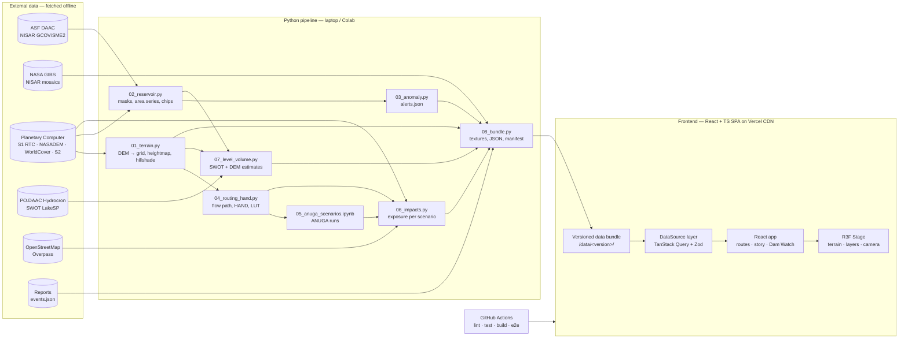
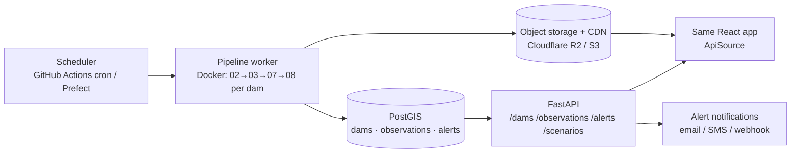
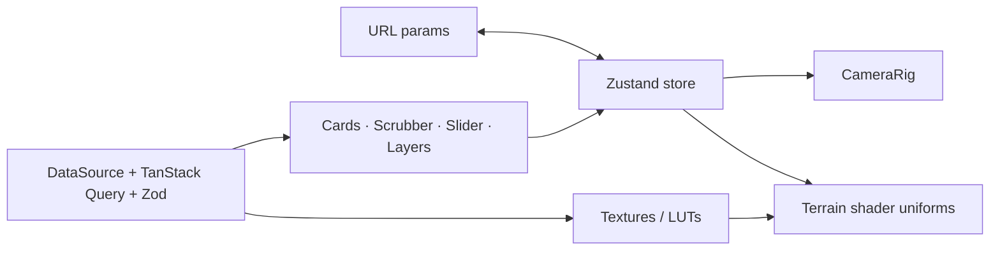

# 06 · System Design

Architecture, repository layout, data contracts, build plan and risks.

---

## 1. Architecture



**Key decisions**
- **Production frontend, no runtime backend in v1.** The React/TypeScript SPA (→ 03 §6, → 04) is built by CI and served from a CDN (Vercel). The pipeline writes a **versioned data bundle** (`/data/<version>/`); the app reads it through a typed `DataSource` layer (→ 03 §6.3). The demo cannot fail because of a third-party API, and hosting is free.
- **Swappable data layer.** The UI never fetches URLs directly. Moving to a live backend later means adding `ApiSource`, with no UI changes.

**Production roadmap (v2, after the hackathon)**

New NISAR pass → worker updates every dam → alerts written to PostGIS → API and notifications. Fully automatic Dam Watch.

The full v2 design (click any dam → automatic dam snapping, upstream catchment, reservoir, downstream path, tiered processing, API contracts) is in → 09. It is a roadmap: v1 ships the static Mellègue bundle.

**Local run in Docker:** `docker compose up --build web` builds the SPA with pnpm from the committed lockfile and serves it with nginx at http://localhost:5173 (`docker/web/Dockerfile`). `docker compose --profile simulation run anuga …` runs the flood model (`docker/anuga/Dockerfile`).

## 2. Repository layout

```
hydrostress/
├─ README.md                    # how to run, credits, licence
├─ LICENSE                      # MIT (code)
├─ config.yaml                  # AOIs, thresholds, scenarios, paths
├─ .env.example                 # EARTHDATA_TOKEN=
├─ requirements.txt
├─ docs/                        # these .md files
├─ pipeline/
│  ├─ common/                   # mellegue_test.py functions as a module (RangeFile, read_gcov, boxcar…)
│  ├─ 00_inventory.py           # = nisar_tunisia_inventory.py / all_platforms.py
│  ├─ 01_terrain.py
│  ├─ 01b_gem15.py              # GEM-15 15 m DTM for the flood valley (→ 09 §3.6)
│  ├─ 02_reservoir.py           # = mellegue_reservoir.py, extended (polygon, chips on the terrain grid)
│  ├─ 03_anomaly.py
│  ├─ 04_routing_hand.py
│  ├─ 05_anuga_scenarios.ipynb  # Colab
│  ├─ 06_impacts.py
│  ├─ 07_level_volume.py
│  ├─ 08_bundle.py
│  └─ run_all.py                # orchestrates; --dam --polygon --skip
├─ cache/                       # (gitignored) raw downloads
├─ work/                        # (gitignored) intermediate GeoTIFFs
├─ apps/
│  └─ web/                      # React + TypeScript + Vite (deployed to Vercel)
│     ├─ index.html
│     ├─ package.json  vite.config.ts  tsconfig.json  tailwind.config.ts  postcss.config.js
│     ├─ .env.example           # VITE_DATA_BASE_URL=/data/2026-11-15  VITE_SENTRY_DSN=
│     ├─ vercel.json            # SPA rewrites, security headers, caching
│     ├─ public/
│     │  ├─ fonts/  icons/  manifest.webmanifest
│     │  └─ data/<version>/     # bundle written by pipeline/08_bundle.py (or served from a CDN bucket)
│     ├─ src/
│     │  ├─ main.tsx  App.tsx  router.tsx
│     │  ├─ app/                # AppShell, providers (Query, i18n, Toaster), ErrorBoundary
│     │  ├─ routes/             # Intro, Story, Watch, Methods, Sources, School, NotFound
│     │  ├─ features/
│     │  │  ├─ intro/           # IntroSequence, NisarSatellite, Hotspot, Hero, Dive
│     │  │  ├─ story/           # ActCard, acts/act1…act9 configs, useActInView, TourController
│     │  │  ├─ timeline/        # TimeScrubber, SwipeHandle
│     │  │  ├─ reservoir/       # ReservoirChart, AlertCard
│     │  │  ├─ flood/           # VolumeSlider, ModeToggle, ImpactCounters, ArrivalTimeline, lut.ts
│     │  │  ├─ level/           # LevelVolumeCard
│     │  │  ├─ watch/           # DamWatchDrawer, DamList, DamView, Downloads
│     │  │  └─ school/          # RadarLab, ThreeSurfaces, Quiz (ported prototype content)
│     │  ├─ scene/              # Stage (Canvas), Terrain, WaterSurface, FlowPath, Villages, DamMarker,
│     │  │  │                   # NisarBeam, CameraRig, Lighting, Effects, shots.ts, quality.ts
│     │  │  └─ shaders/         # terrain.vert.glsl, terrain.frag.glsl, water.frag.glsl
│     │  ├─ components/ui/      # shadcn/Radix: button, slider, dialog, sheet, popover, tooltip, switch, toast
│     │  ├─ components/         # Badge, Hud, Caption, Letterbox, LayerPanel, GlossaryTerm, LevelSwitch, DataState
│     │  ├─ data/               # DataSource interface, StaticBundleSource, Zod schemas (one per contract §3), hooks (useManifest…)
│     │  ├─ store/              # Zustand store, useUrlSync
│     │  ├─ workers/            # terrain.worker.ts (Comlink)
│     │  ├─ hooks/              # useReadAloud, useReducedMotion, useBreakpoint, useHotkeys
│     │  ├─ locales/en/         # common.json, acts.json, glossary.json  (fr/, ar/ later)
│     │  ├─ styles/             # tokens.css, tokens.ts, globals.css
│     │  └─ motion/variants.ts
│     ├─ tests/                 # Vitest unit/component tests
│     ├─ e2e/                   # Playwright specs (+ axe)
│     └─ .storybook/
├─ reference/
│  └─ NISAR-HydroStress-Cinematic-Intro.html   # prototype: visual & behaviour reference only
└─ .github/workflows/
   ├─ web-ci.yml                # install → typecheck → lint → unit → build → Playwright + axe → Lighthouse CI
   └─ pipeline-ci.yml           # ruff + pytest on pipeline/ (synthetic fixtures)
```

## 3. Data bundle & contracts

```
apps/web/public/data/<version>/
├─ manifest.json
├─ terrain/  height_scene.png  hillshade.png  basemap_s2.jpg  grid.json
├─ radar/    2026-06-17_S1_o88_VV.png  2026-06-19_NISAR_D80_HH.png  …  (+ _mask.png, change_*.png)
├─ timeseries/ reservoir_area.json
├─ anomaly/  alerts.json
├─ vectors/  lake_max.geojson  flowpath.geojson  villages.geojson  roads.geojson  dams.geojson
├─ flood/    hand.png  hand_lut.json  anuga/index.json  anuga/<scenario>/{maxdepth.png, arrival.png, frames/*.png, stats.json}
├─ impacts/  impacts.json
├─ level/    level_volume.json
└─ story/    events.json  acts.json  glossary.json  sources.json
```

### 3.1 `terrain/grid.json`
```json
{
  "crs": "EPSG:32632",
  "bounds_m": [xmin, ymin, xmax, ymax],
  "bounds_lonlat": [8.45, 36.10, 9.50, 36.75],
  "res_m": 30,
  "size_px": [width, height],
  "height_encoding": {"type": "rg16", "scale": 0.1, "offset": -100},
  "z_min": 140, "z_max": 1250,
  "lake_chip": {"bounds_m": [...], "res_m": 10, "size_px": [700, 450]}
}
```
Every raster in `radar/` and `flood/` is either on the **scene grid** or on the **lake chip grid** (stated per layer in the manifest).

### 3.2 `manifest.json` (layer catalogue)
```json
{
  "version": "2026-11-15T08:00Z",
  "layers": [
    {
      "id": "nisar_2026-06-19_D80_HH",
      "kind": "radar", "grid": "lake_chip",
      "date": "2026-06-19", "time_utc": "05:xx",
      "sensor": "NISAR", "band": "L", "pol": "HH", "track": "D80", "frame": 70,
      "product_id": "NISAR_L2_PR_GCOV_…",
      "file": "radar/2026-06-19_NISAR_D80_HH.png",
      "encoding": {"type": "db8", "min_db": -25, "max_db": 0},
      "mask": "radar/2026-06-19_NISAR_D80_mask.png",
      "badge": "MEASURED",
      "source": "NASA/JPL–ISRO NISAR via ASF DAAC",
      "method": "γ0 HH, boxcar 5×5, water < −18 dB"
    }
  ]
}
```

### 3.3 `timeseries/reservoir_area.json`
```json
{
  "reservoir": "Mellègue",
  "polygon": "vectors/lake_max.geojson",
  "unit": "km2",
  "points": [
    {"date": "2026-06-17", "time_utc": "17:20", "sensor": "S1", "track": "o88", "area": 0.0, "area_norm": 0.0, "confidence": "high", "layer": "s1_2026-06-17_o88_VV"},
    {"date": "2026-06-19", "sensor": "NISAR", "track": "D80", "area": 0.0, "area_norm": 0.0, "confidence": "high", "layer": "nisar_2026-06-19_D80_HH"}
  ],
  "events": [{"date": "2026-06-17", "label": "Gate failure ~21:15"}, {"date": "2026-07-16", "label": "Gate repaired"}],
  "gaps": [["2026-07-25", "2026-08-13"]]
}
```

### 3.4 `anomaly/alerts.json`
```json
{
  "rule": {"z_alert": -3, "drop_alert": -0.15, "z_warn": -2, "drop_warn": -0.08, "seasonal_rate_per_day": -0.006},
  "evaluations": [
    {"date": "2026-06-19", "prev": "2026-06-17", "days": 1.5, "delta": -0.0, "expected": -0.0, "z": 0.0,
     "level": "ALERT", "cross_sensor": true,
     "text": {"everyone": "…", "experts": "…"}}
  ]
}
```

### 3.5 `flood/hand_lut.json`
```json
{
  "corridor": "vectors/corridor.geojson",
  "reach": "dam→Sidi Salem",
  "hand_encoding": {"type": "r16", "scale": 0.01},
  "rows": [{"h": 0.25, "V_m3": 0, "area_km2": 0, "cropland_ha": 0, "builtup_ha": 0, "villages": 0, "road_km": 0}]
}
```
Browser: V (slider) → binary search over `V_m3` → interpolate `h` → `uHandH = h`.

### 3.6 `flood/anuga/index.json`
```json
{
  "scenarios": [
    {"id": "v21_d12", "volume_m3": 21e6, "duration_h": 12, "label": "June 2026 reconstruction", "badge": "MODELLED",
     "files": {"maxdepth": "anuga/v21_d12/maxdepth.png", "arrival": "anuga/v21_d12/arrival.png", "frames": "anuga/v21_d12/frames/{i}.png", "n_frames": 96, "dt_s": 1800},
     "depth_encoding": {"type": "r8", "max_m": 8},
     "stats": "anuga/v21_d12/stats.json"}
  ]
}
```
`stats.json`: `{mass_balance_err, peak_Q_m3s, inundated_km2, arrival_h: {"Jendouba": 9.5, …}, max_depth_m: {...}}`.

### 3.7 `impacts/impacts.json`
```json
{"v21_d12": {"cropland_ha": 0, "builtup_ha": 0, "buildings": 0, "road_km": 0,
             "villages": [{"name": "…", "arrival_h": 0, "max_depth_m": 0}]},
 "hand": "see hand_lut.json"}
```

### 3.8 `level/level_volume.json`
```json
{"swot": {"lake_id": "…", "points": [{"time": "…", "wse_m": 0, "wse_u": 0, "area_km2": 0, "quality": 0}]},
 "dem_shoreline": [{"date": "2026-06-19", "level_m": 0, "sigma_m": 0}],
 "delta_volume": [{"from": "2026-06-17", "to": "2026-07-01", "dV_m3": 0, "low": 0, "high": 0, "method": "A×Δh"}],
 "reported": [{"what": "Released volume", "value_m3": 21e6, "alt": 29e6, "source": "…"}]}
```

## 4. Frontend architecture

Full stack and conventions: → 03 §6; components and design system: → 04.

| Area | Main units | Responsibility |
|---|---|---|
| App shell | `AppShell`, `router.tsx`, providers | Routes, lazy chunks, Query/i18n/Toaster providers, global ErrorBoundary |
| Stage | `scene/Stage.tsx` (persistent `<Canvas>`) | Mounted once under the shell, so the 3D scene survives route changes |
| Scene | `Terrain`, `WaterSurface`, `FlowPath`, `Villages`, `DamMarker`, `NisarBeam`, `Effects` | Layers driven by store selectors |
| Camera | `CameraRig`, `shots.ts` | GSAP tweens between named shots; spline follow; reduced-motion cuts |
| Story | `features/story` | Act configs (shot, date, layers, try-its, i18n keys); `useActInView`; Tour |
| Controls | `TimeScrubber`, `SwipeHandle`, `LayerPanel`, `VolumeSlider` | Write to the store; the store pushes uniforms to the shader |
| Data | `data/DataSource.ts`, `StaticBundleSource`, `schemas/*.ts`, `useManifest()`, `useReservoirArea()`… | Typed, validated, cached loading |
| Store | `store/app.ts`, `useUrlSync` | Single source of UI state (→ 04 §9), mirrored to the URL |
| Workers | `terrain.worker.ts` | Heightmap decode, normals, LUT |

**Data flow**


**Act configuration** (`features/story/acts/act3.ts`, illustrative):
```ts
export const act3: ActConfig = {
  id: 3, shot: 'lake_top', date: '2026-06-19',
  layers: { basemap: true, radar: true, mask: false },
  swipe: { before: 's1_2026-06-17_o88_VV', after: 'nisar_2026-06-19_D80_HH', at: 0.5 },
  scrubber: { enabled: true, dates: ['2026-06-19','2026-06-21','2026-07-01','2026-07-03','2026-07-13','2026-07-15'] },
  tryIts: ['swipe', 'play', 'lab:water', 'layer:change'],
  badges: ['measured'],
  copy: 'acts.3',          // i18n namespace with title, body.everyone, body.experts, lens, sources
};
```

**Shader uniforms (terrain.frag):** `uHeight`, `uBase`, `uRadarA`, `uRadarB`, `uMaskA`, `uChange`, `uHand`, `uHandH`, `uDepth`, `uSwipe`, `uOpacity` (vec4), `uLakeChipRect`, `uNight`, `uExag`.

## 5. Processing plan (commands)

```bash
# once
pip install -r requirements.txt
export EARTHDATA_TOKEN=...            # Windows: set EARTHDATA_TOKEN=...

python pipeline/01_terrain.py      --config config.yaml           # NASADEM → grid, heightmap, hillshade, S2 basemap
python pipeline/02_reservoir.py    --config config.yaml           # NISAR + S1 masks, area series, chips (uses cache)
python pipeline/03_anomaly.py      --config config.yaml
python pipeline/04_routing_hand.py --config config.yaml           # flow path, HAND, LUT
# Colab: open pipeline/05_anuga_scenarios.ipynb → run scenarios → download outputs to work/anuga/
python pipeline/06_impacts.py      --config config.yaml
python pipeline/07_level_volume.py --config config.yaml           # Hydrocron + DEM methods
python pipeline/08_bundle.py       --config config.yaml --out apps/web/public/data/2026-11-15

# frontend
cd apps/web
pnpm install
pnpm dev                     # http://localhost:5173
pnpm test && pnpm e2e        # Vitest + Playwright (+ axe)
pnpm build && pnpm preview   # production build check
# deploy: push to main → GitHub Actions → Vercel (preview deploys on every PR)
```

## 6. Build schedule (to 16:30 Sunday)

| # | Task | Owner | Depends | Est. | Priority |
|---|---|---|---|---|---|
| 1 | Run `mellegue_reservoir.py`; confirm numbers | Data | — | 1 h | P0 |
| 2 | `01_terrain.py` (heightmap, hillshade, basemap) | Data | — | 1.5 h | P0 |
| 3a | Scaffold `apps/web` (Vite + React + TS, Tailwind, shadcn/ui, R3F, Zustand, Query, Zod, i18n, Vitest, Playwright, CI, Vercel) | Front | — | 1.5 h | P0 |
| 3b | Port the intro to R3F + GSAP (satellite, chapters, hero, dive) and retune lighting; at the end of the dive navigate to `/story/1` | Front | 3a | 3 h | P0 |
| 4 | `Stage`, `Terrain` shader, `CameraRig` + shots, quality tiers | Front | 2, 3a | 3 h | P0 |
| 5 | `02_reservoir.py` chips on the lake grid + polygon + JSON | Data | 1 | 1.5 h | P0 |
| 6 | Story acts 1–6, scrubber, swipe, chart, alert card | Front | 4, 5 | 4 h | P0 |
| 7 | `03_anomaly.py` | Data | 5 | 0.5 h | P0 |
| 8 | `04_routing_hand.py` + LUT | Data | 2 | 2 h | P0/P1 |
| 9 | ANUGA Colab: v21_d12 first, then v50, v195 | Model | 2, 8 | 3–4 h (background) | P1 |
| 10 | `features/flood` (VolumeSlider, counters, LUT) + `06_impacts.py` | Front/Data | 8 | 2.5 h | P1 |
| 11 | `07_level_volume.py` (SWOT, DEM) + Act 8 | Data | 5 | 2 h | P1 |
| 12 | Dam Watch drawer, sources, methods page | Front | 6 | 2 h | P1 |
| 13 | Accessibility (axe clean), reduced motion, mobile bottom sheet, 2D fallback, PWA precache | Front | 6 | 2 h | P1 |
| 14 | Validation runs (→ 07), fill [TBD] text | All | 5–11 | 1.5 h | P0 |
| 15 | Production deploy on Vercel; CI green; test the public URL in a private window | Front | all | 0.5 h | P0 |
| 16 | 30 s video (tour capture) / 7 slides, project page | Pitch | 15 | 2 h | P0 |
| 17 | Rehearse 7-min pitch | All | 16 | 0.5 h | P0 |

**Cut line if late:** keep CI to typecheck + build + one Playwright smoke test (add Storybook and Lighthouse CI after the hackathon); drop Acts 8–9 to cards without interaction; keep the HAND slider and one ANUGA scenario; Dam Watch becomes a single panel for Mellègue.

## 7. Risks & mitigations

| Risk | Likelihood | Impact | Mitigation |
|---|---|---|---|
| ASF downloads slow/reset (WinError 10054) | High | Delays data | Cache + retries already in `RangeFile`; read only the AOI window; GIBS PNG fallback textures |
| PROJ conflict on Windows (PostGIS) | Seen | Scripts crash | Env guard at the top of every script |
| ANUGA too slow or fails to install | Medium | No physics scenarios | Colab; coarser mesh; `run-anuga` exe; if all fails → HAND only with honest labelling |
| DEM lacks the channel detail | High | Unrealistic depths | Use the GEM-15 15 m DTM in the valley when it passes test D2 (→ 09 §3.6); channel burn documented; show depth classes, not exact values; "screening" banner |
| SWOT has no lake ID / no passes | Medium | Act 8 thinner | DEM shoreline method + reported volumes; say so |
| Area mask contaminated by dry fields | Seen | Wrong numbers | Lake polygon restriction + connectivity + visual QA of every chip |
| Bundle too heavy | Medium | Slow demo | WebP/JPEG for basemap, 8-bit radar PNGs, lazy-load per act, cap at 15 MB initial |
| WebGL issues on the jury laptop | Low | Demo breaks | 2D fallback + recorded video as a backup |
| Over-claiming | Medium | Validity score | Badges, limits slide, validation page |
| Porting the intro to modern three.js changes its look | Medium | Visual regressions | Side-by-side screenshots against `reference/`; retune lights/colour space; keep the GSAP timings |
| React re-renders slow the 3D scene | Medium | Low FPS | Store selectors inside the Canvas, refs for uniforms, no React state per frame, `useFrame` for animation |
| Production stack takes longer to set up than a single HTML file | High (deadline) | Less time for features | Scaffold first (task 3a) with a template; parallelise: data team works on the pipeline meanwhile |
| Data-contract drift between Python and TS | Medium | Broken layers | Zod schemas mirror §3; the pipeline writes a `schema_version`; a CI test validates sample bundle files |

## 8. Security & privacy

- Security headers and CSP set in `vercel.json` (→ 03 §6.5); dependencies checked with `pnpm audit` and Dependabot.
- No user data collected; no cookies; `localStorage` only for level/intro-skip preferences (wrapped in try/catch).
- Tokens only in `.env` (gitignored); CI secrets if automation is added.
- OSM building data used in aggregate (counts), not individual addresses.