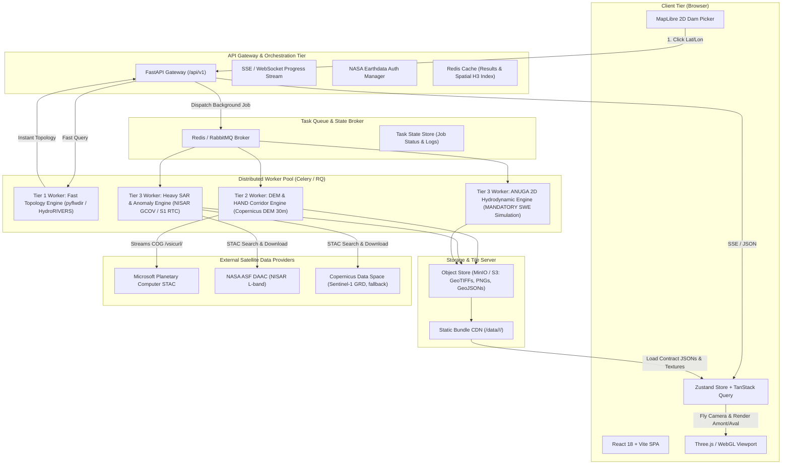
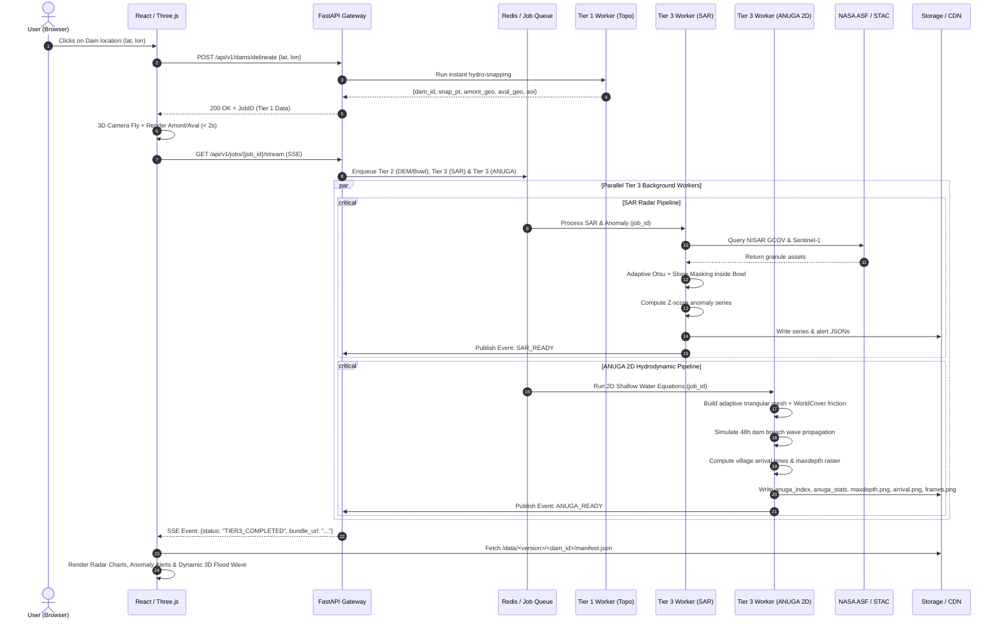
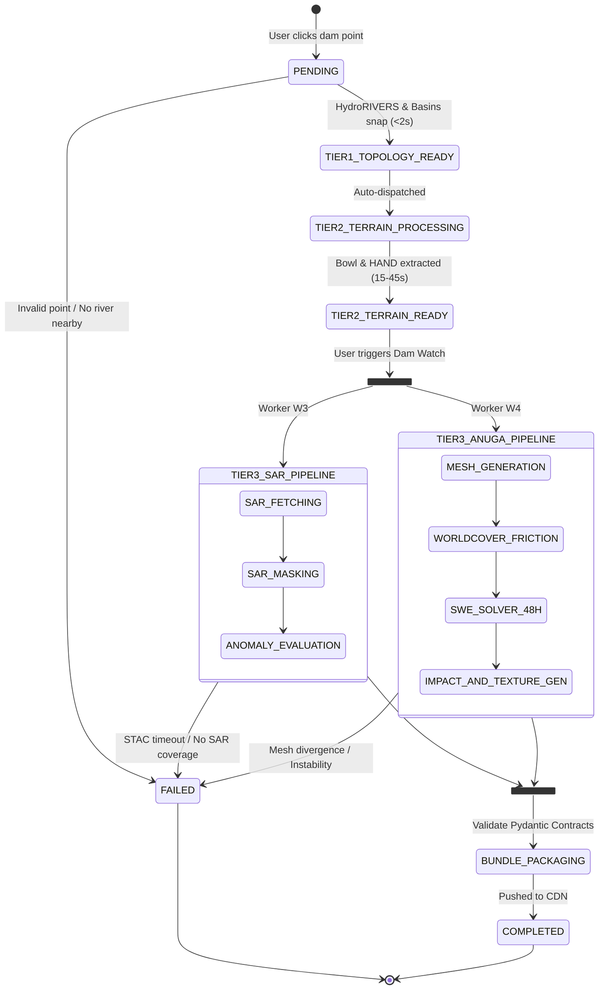

# 09 · Generalization & Automated River/Catchment Detection (v2 roadmap)

> **From the Mellègue Pilot to Global Dam Watch**  
> *How to turn a single-site NISAR radar investigation into an open, automated platform applicable to any dam on Earth.*

> **Status of this document (verified 14 Nov 2026).** This is the **v2 roadmap** of *Dancing with the Rivers*. The hackathon build (v1, → 06 §1) stays a static site with a precomputed Mellègue bundle; nothing here is on the critical path to the 16:30 submission. What v1 takes from this plan is listed in §0.3. Every factual claim below was checked against the repository's outputs and the sources in → 01 §10; corrections are listed in §0.1.

## 0. Verification & integration

### 0.1 Corrections made to the first draft

| Draft said | Verified | Source |
|---|---|---|
| "a bottom gate failed" | The **upper sector gate** failed, during a planned 100,000 m³ irrigation release | → 01 §6 |
| "21 million m³ drained over 12 hours" | Reports say "in a few hours" (one outlet: 29 Mm³), with flows continuing for days. **12 h is our scenario assumption**, not a fact | → 01 §6, → 03 §5.7 |
| "anomalous drawdown detected (z-score < −3.0)" | The z-score pair rule **failed validation**. The working rule: harmonised area **more than 20% below the 21-day multi-sensor baseline, confirmed by an independent pass within 6 days**. First ALERT **22 Jun 2026** (5 days after), 0 flags before the failure | `work/anomaly/report.md`, CLAUDE.md §8 |
| "tracking downstream wetness progression" | Only a faint brighter line along the channel: a hint, not a measurement | → 01 §7 |
| Catchment "~10,400 km²" / API example 10420.5 | **10,315 km²** (HydroBASINS level 12, 79 sub-basins); Sidi Salem 18,069 km² | `work/context/report.md` |
| "reaches Sidi Salem in 92 hours, floods villages in 3 to 12 hours" | **Not computed.** Reported arrival at Sidi Salem is 21 Jun (about 4 days). Village arrival times come only from ANUGA runs that pass tests E1–E7 | → 07 §6 |
| "GRanD v1.3: 6,862 dams" | GRanD v1.3 lists **7,320** dams (6,862 was v1.1). Re-check on the GRanD page before citing | GRanD documentation |
| "Sentinel-1 RTC from Copernicus Data Space" | CDSE serves GRD/SLC, not RTC. We read **Sentinel-1 RTC from Microsoft Planetary Computer** (STAC). NISAR comes from **ASF via `asf_search`**, not STAC | `pipeline/02a_reservoir_series.py` |
| Tier 3 in "2–5 minutes", including a 48 h ANUGA run | Measured: NISAR window reads take 15–35 s per product (41 products ≈ 15 min cold); an ANUGA scenario targets ≤ 45 min. Tier 3 is **tens of minutes to hours**: a queued job with a cached result | `work/reservoir_run.log`, → 03 §5.7 |
| "ANUGA is strictly mandatory" | True for arrival times and velocities. v1 keeps the documented fallback: if ANUGA is not ready, ship HAND only, labelled as screening | → 06 §6 (cut line) |
| "No water can exist outside the DEM contour at crest level" | A sound **upper bound**, but a 30 m DEM does not resolve the crest, and it records the **water surface on the day it was acquired**. Take crest height from GRanD/OSM and combine the bowl with observed water (§4.2 step 2) | → 07 §2.2 |
| `from delineator import delineate` returning three GeoDataFrames | `delineator` 2.2.4 exists on PyPI (Python ≥ 3.10), but this call signature is **unverified**: test before relying on it. Check the MERIT-Hydro licence for the intended use | PyPI |
| `05_anuga_simulation.py` | The script is `pipeline/05_anuga_scenarios.py` (runs in the `dwd-anuga:1` Docker image) | repo |

### 0.2 What the Mellègue pilot taught us (constraints for any generalisation)

1. **A fixed water threshold does not transfer**, even between dates at one site (wind at C-band, wet mud at L-band). Thresholds must be per image (Otsu in lake + ring), and area must be counted inside a lake mask.
2. **Static reservoir polygons are wrong.** OSM gives 2.03 km² for Mellègue; the pre-failure radar extent is about 2.6–3.2 km². The robust mask is the **water frequency over the months before the period of interest** (Sentinel-1 archive), bounded by JRC Global Surface Water maximum extent and the DEM bowl.
3. **Area alone lags after a release** (wet sediment looks like water at L-band). The median backscatter inside the lake mask reacts at once; a generic detector should carry both indicators.
4. **Single-pair change tests are too noisy**; a rolling baseline with independent confirmation works.
5. **Snapping was easy here** (dam point 5 m from the OSM crest line, 60 m from the HydroRIVERS main stem), but that is one site; the risks in §4.1 are real elsewhere.

### 0.3 What v1 (the hackathon build) takes from this plan

| Item | v1 action | Owner |
|---|---|---|
| Amont / aval vocabulary and layers | The catchment polygon (10,315 km²), the HydroRIVERS network and the D8 flow path go in the bundle; Act 9 shows them as "how any dam is set up" | frontend-ui |
| Multi-dam readiness | Contracts and the `DataSource` are keyed by `dam_id` (done). Bundle path stays `/data/<version>/` in v1 | — |
| Other reservoirs as proof | 344 OSM reservoirs and 251 dams over northern Tunisia are in `work/context/`; Act 9 lists a few (no time series) | frontend-ui |
| **GEM-15 terrain (§3.6)** | 15 m DTM for the flood valley downloaded and compared with NASADEM (`pipeline/01b_gem15.py`); used for HAND and ANUGA if it passes test D2 | hydro-modeler |
| `docker/web` | Kept, rebuilt on pnpm with the committed lockfile (`docker compose up --build web` → http://localhost:5173) | lead |
| API gateway, queue, workers, MapLibre picker, H3 cache | **Not in v1.** Shown as the roadmap slide | — |

---

## 1. Introduction: The Mellègue Reference Use Case

### 1.1 The Pilot Site
In the night of **17–18 June 2026**, the upper sector gate failed at the **Mellègue dam** in north-western Tunisia (built in 1954, $36.3142^\circ\text{N}, 8.7026^\circ\text{E}$). About **$21\text{ million m}^3$** (REPORTED; one outlet says 29) escaped into the Oued Mellègue "in a few hours", sending an unseasonal flood wave down the Medjerda valley toward the downstream **Sidi Salem dam**.

Because clouds, dust, and darkness hinder optical satellites, **NASA–ISRO NISAR (L-band SAR)** and **Copernicus Sentinel-1 (C-band SAR)** served as the primary observational eye:
- Penetrating weather and night to measure reservoir water surface area ($km^2$).
- Detecting anomalous drawdown within 5 days of the failure (area more than 20% below the 21-day baseline, confirmed by an independent pass; first ALERT 22 Jun).
- Showing a faint wetter line along the downstream channel (a hint only, → 01 §7).

```
       [ Upstream Catchment: Oued Mellègue Basin ]
                     (Amont: 10,315 km²)
                              │
                              ▼
                   ╔═════════════════════╗
                   ║    Mellègue Dam     ║  ◄── User Dam Point
                   ║  (Barrage Mellègue) ║
                   ╚═════════════════════╝
                              │
                              ▼
                 [ Downstream Flowpath / Oued ]
                   (Aval: Medjerda Valley)
                              │
                              ▼
                   ╔═════════════════════╗
                   ║   Sidi Salem Dam    ║  ◄── Downstream Buffer
                   ║     Reservoir       ║
                   ╚═════════════════════╝
```

### 1.2 The Generalization Goal
The Mellègue case validated the core scientific and engineering methodology:
1. **Radar water segmentation** (adaptive Otsu on SAR backscatter).
2. **Multi-sensor anomaly detection** (rolling baseline departure + cross-sensor confirmation).
3. **Hydrodynamic impact simulation** (HAND terrain routing & ANUGA shallow-water equations).

**The Next Frontier:** The user drops a pin `(lon, lat)` anywhere on the world map. The system must automatically detect:
1. **The Dam & Pour Point**: Snap user clicks to the exact hydraulic outlet.
2. **The Amont (Upstream Watershed & Rivers)**: Delineate the contributing catchment and tributary network.
3. **The Reservoir Lake**: Identify the water body impounded behind the dam wall.
4. **The Aval (Downstream River / Oued)**: Trace the downstream drainage path through valleys and settlements toward the sea or next reservoir.
5. **Dynamic AOI Generation**: Automatically compute tight lake, scene, and valley bounding boxes so the satellite radar pipeline can run without manual coordinates.

---

## 2. Current Project State & Audit

### 2.1 What Already Exists
- **HydroSHEDS Integration (`pipeline/00_context_data.py`)**:
  - The project already downloads `HydroRIVERS v1.0` and `HydroBASINS v1c` (Africa).
  - Lines 707–749 feature a working `catchment()` function:
    ```python
    def catchment(b12, rivers_u, pt_u, label: str, read_bbox) -> dict:
        # Snaps dam point to nearest HydroRIVERS reach (within 3 km)
        # Finds containing HydroBASINS level 12 polygon
        # Traces upstream using NEXT_DOWN adjacency graph
        # Returns dissolved watershed polygon + area (km²)
    ```
- **Generic Data Contracts (`pipeline/common/contracts.py`)**:
  - All pydantic models (`ReservoirArea`, `Alerts`, `HandLut`, `Impacts`, `LevelVolume`) are keyed by `dam_id: str`.
- **Web Store & Data Layer (`apps/web/src/data/DataSource.ts`)**:
  - The `DataSource` interface accepts `damId` on all methods (`reservoirArea(damId)`, `alerts(damId)`, etc.).
  - The Zustand store has `damId` state and `setDamId()` action.

### 2.2 Where the Project Was Hardcoded
| Component | Current Hardcoded State | Required Generalized Behavior |
|-----------|-------------------------|-------------------------------|
| `config.yaml` | `dam.id: mellegue`, fixed lat/lon, fixed AOI bounding boxes (`scene`, `valley`, `lake`) | Dynamic config generated per dam or stored in a multi-dam registry |
| `pipeline/02_reservoir.py` | `CHIP_DATES` static list of Sentinel-1 / NISAR dates | Dynamic STAC API query for any SAR granule covering the generated `aoi.lake` |
| `pipeline/08_bundle.py` | Hardcoded UTM coordinates and Mellègue drawdown fixture curves | Generalized fixture generator derived from auto-computed bounding box & DEM elevation |
| `apps/web/.../StaticBundleSource.ts` | `assertDam()` throws `DataNotFoundError` if `m.dam_id !== damId` | Multi-dam bundle directory structure `/data/<version>/<dam_id>/` or dynamic backend API |
| Coordinate System | Hardcoded to `EPSG:32632` (UTM 32N) | Auto-detect UTM zone from longitude: `EPSG:32600 + floor((lon + 180)/6) + 1` |

---

## 3. Evaluated Open-Source Solutions

To extract the **amont**, **aval**, and **reservoir** automatically from a user coordinate, five open-source libraries and datasets were evaluated:

### 3.1 `delineator` (Top Recommendation for Fast Implementation)
- **Author:** Matthew Heberger (`mghydro.com/watersheds`)
- **Package:** `pip install delineator` (Python $\ge 3.10$)
- **Data Source:** MERIT-Hydro + MERIT-Basins (~90m global hydrography).
- **Capabilities:**
  - Automatically downloads required regional MERIT tiles on demand.
  - Automatically snaps input `(lat, lon)` to the nearest high-accumulation stream channel.
  - Returns GeoDataFrames for **upstream watershed boundary**, **river network lines**, and **outlet point**.
```python
from delineator import delineate

# One function call handles snapping, upstream basin, and stream network
watershed_gdf, rivers_gdf, outlets_gdf = delineate(lat=36.3142, lon=8.7026)

watershed_gdf.to_file("amont_catchment.geojson", driver="GeoJSON")
rivers_gdf.to_file("river_network.geojson", driver="GeoJSON")
```

### 3.2 `pyflwdir` (Top Recommendation for High Performance & Custom Raster DEMs)
- **Author:** Deltares
- **Package:** `pip install pyflwdir rasterio geopandas`
- **Capabilities:**
  - Numba-optimized flow direction engine (handles MERIT-Hydro, COP-DEM, or NASADEM rasters).
  - Explicit **downstream flowpath tracing** (`flw.path(idxs=snap_idx, direction="down")`) to map the exact **aval** river reach.
  - Upstream catchment delineation (`flw.basins()` or `flw.upstream_area()`).
  - Strahler stream ordering and vector line extraction (`flw.streams()`).
```python
import pyflwdir, rasterio

with rasterio.open("merit_hydro_flwdir.tif") as src:
    flw = pyflwdir.from_array(src.read(1), ftype="d8", transform=src.transform, latlon=True)

# 1. Snap dam point to river
snap_idx, dist = flw.snap(xy=([8.7026], [36.3142]), mask=flw.upstream_area("km2") > 50)

# 2. Trace downstream (AVAL)
down_idxs, down_dists = flw.path(idxs=snap_idx, direction="down")
down_lons, down_lats = flw.xy(down_idxs)

# 3. Upstream catchment (AMONT)
catchment_mask = flw.basins(idxs=snap_idx)
```

### 3.3 HydroSHEDS / HydroRIVERS Graph Navigation (In-Repo Native)
- **Location:** Already cached under `cache/context/hydrosheds/`.
- **Method:**
  - Every river reach in `HydroRIVERS` contains `HYRIV_ID` and `NEXT_DOWN`.
  - **Aval (Downstream):** Recursively follow `NEXT_DOWN` pointers until reaching a downstream confluence, lake, or the sea.
  - **Amont (Upstream):** Query all reaches where `NEXT_DOWN == current_id` (reverse graph lookup).

### 3.4 OpenStreetMap Overpass & Global Dam Databases
- **Dam Attributes & Geometry:**
  - OSM query: `nwr["waterway"="dam"]` or `nwr["man_made"="dam"]` around the user point ($\le 1\text{ km}$).
  - Global Reservoir and Dam Database (**GRanD v1.3**, 7,320 dams) / **HydroLAKES v1.0**: large dams with storage capacity, reservoir polygon, and main river name.
- **Reservoir Extent (Lake):**
  - OSM `water="reservoir"` or `natural="water"` polygon intersecting the dam buffer.
  - JRC Global Surface Water (GSW) permanent water occurrence raster ($> 80\%$ occurrence).

### 3.5 Decision for this project

Keep the **in-repo HydroSHEDS graph** (§3.3) for amont and the **D8 path on the DEM** (`pipeline/04_routing_hand.py`) for aval: both are validated on Mellègue. `pyflwdir` is the upgrade path for global use (it needs Python ≥ 3.11, which matches our venv). `delineator` is an optional cross-check of the catchment area.

### 3.6 GEM-15: a 15 m elevation model (new resource, verified)

| Property | Value |
|---|---|
| What | *GEM-15: Near-Global Surface and Terrain Elevation Models (15 m)*, Google Research. **Experimental, under review** |
| Content | `dsm` (surface, with p5/p50/p95/std) and **`dtm` (bare earth, predicted by a deep-learning model)**, 15 m, local UTM, heights above the EGM96 geoid (as NASADEM) |
| Source | Sub-metre optical stereo, mostly 2022–2024 Pléiades Neo |
| Coverage | 60°S–84°N, **excluding Russia, China, Mongolia, Greenland and Antarctica**; India is offset |
| Access | Earth Engine `projects/climate-and-sustainability/assets/gem-15_v1`, **and public COGs** at `https://storage.googleapis.com/climate-and-sustainability/gem-15/` with a static STAC catalogue (no account needed) |
| Licence | CC-BY 4.0, attribution "This dataset is produced by Google". Cite Batchu et al. (2026), EarthArXiv, doi:10.31223/X55N75 |
| Stated limits | Regional mean offsets of several metres vs lidar (−4.8 to +1.9 m); **water bodies masked (+9 m buffer)**; cells differing by more than 50 m from Copernicus GLO-30 masked; seams at acquisition boundaries |

**Our test (14 Nov, `pipeline/01b_gem15.py`).** Tiles `w8s36` and `w9s36` are native EPSG:32632. Over the dam → Sidi Salem valley (5694 × 3708 cells at 15 m), **99.2% of cells are valid**; GEM-15 DTM − NASADEM has median **−0.96 m**, 5–95% range −5.8 to +3.5 m, robust σ 2.4 m. Gaps (water, masked cells) are filled from NASADEM shifted by the median offset. Output: `work/gem15_dtm_15m.tif`.

**Use in the project**
- **Flood modelling (→ 03 §5.5–5.7).** The top modelling risk in → 06 §7 is that 30 m DEMs smooth the river channel. GEM-15 halves the cell size and is a bare-earth model from 2022–2024 imagery, so it is the preferred bed for HAND and ANUGA **if** the D8 path on it passes test D2 (≥ 90% of vertices within 300 m of the mapped river). Otherwise NASADEM stays and the comparison is reported.
- **Level from shoreline (→ 07 §2.2).** The reservoir is masked as water in GEM-15, so it gives no bathymetry; but its 2022–2024 waterline may be lower than SRTM's (Feb 2000), which would widen the range where Method B works. To test.
- **3D scene.** Stays on NASADEM in v1 (the 46 m web grid does not benefit).
- **Badge.** MEASURED (derived product), with "experimental" in the method line. Where GEM-15 has no coverage, fall back to Copernicus GLO-30.

---

## 4. Accuracy Analysis: Can We Create a More Accurate Process?

> [!IMPORTANT]
> **Is the baseline architecture complete and accurate enough?**  
> **No.** The baseline architecture (pure 90m D8 snapping + static OSM polygon) is a great starting prototype, but suffers from **three severe hydrological inaccuracies** when deployed globally. Below is how we enhance accuracy to scientific grade.

### 4.1 Pitfalls of the Naive Baseline
1. **Snapping Disasters in Mountainous/Gorge Terrain:**
   - In steep valleys, a naive Euclidean snap ($\le 3\text{ km}$) can snap across a mountain ridge into an adjacent valley or connect to a minor headwater tributary instead of the main stem. This leads to an inverted or missing upstream watershed.
2. **Outdated / Static Reservoir Polygons:**
   - OSM reservoir polygons are manually digitized from a single historical optical image (often at full capacity). In semi-arid regions, reservoirs shrink by $50\text{--}90\%$ during summer droughts. Using a static polygon contaminates SAR analysis with dry fields, rocks, and vegetation.
3. **Radar Shadow Contamination in SAR:**
   - Deep valleys produce radar shadows (very low backscatter, $\le -22\text{ dB}$) that a naive Otsu threshold falsely classifies as water, yielding false reservoir spikes or ghost floods.

### 4.2 The High-Accuracy Multi-Stage Methodology

```
┌────────────────────────────────────────────────────────────────────────────────┐
│                      HIGH-ACCURACY HYDROLOGICAL PIPELINE                       │
└────────────────────────────────────────────────────────────────────────────────┘
 [User Click: Lat, Lon]
          │
          ▼
 1. MULTI-CRITERIA DAM SNAPPING & HYDRO-ENFORCEMENT
    • Query OSM / GRanD / GeoDAR for dam crest vector line.
    • Stream Burning: Burn vector river reach into the DEM (GEM-15 15 m DTM where available, else GLO-30 / NASADEM).
    • Snap to intersection of dam wall & maximum Flow Accumulation cell.
          │
          ▼
 2. HYPSOMETRIC DEPRESSION FILLING (THE RESERVOIR "BOWL")
    • Dam crest elevation Z_crest from GRanD / OSM height + DEM at the toe (a 30 m DEM does not resolve the crest).
    • Intersect with observed water: pre-period Sentinel-1 water frequency and JRC GSW maximum extent.
    • Run backward depression fill / contour trace upstream up to Z_crest.
    • Output: The theoretical maximum full-supply pool (bathymetric boundary).
      --> upper bound: water outside this contour is a false positive.
          │
          ▼
 3. SLOPE-MASKED ADAPTIVE SAR WATER SEGMENTATION
    • Clip multi-temporal NISAR (L-band) & Sentinel-1 (C-band) to the bowl.
    • Terrain Slope Gate: Mask out all pixels with slope > 15° (eliminates radar shadows).
    • Apply Refined Lee 5x5 speckle filter.
    • Bi-modal Otsu dynamic thresholding within the masked bowl.
    • Cross-validate with Sentinel-2 optical MNDWI when cloud cover < 20%.
          │
          ▼
 4. HAND-BASED FLOODPLAIN EXTRACTION FOR THE AVAL (DOWNSTREAM OUED)
    • Compute 30m Height Above Nearest Drainage (HAND) along the downstream path.
    • Extract variable-width active floodway corridors for h = 1m, 2m, 5m, 10m stages
      instead of an unrealistic 1D centerline.
          │
          ▼
 5. MANDATORY ANUGA 2D HYDRODYNAMIC DAM-BREAK SIMULATION
    • Build unstructured finite-volume triangular mesh on aoi.valley refined to ≤ 2500 m² in the river bed.
    • Map spatially-varying Manning's friction n directly from ESA WorldCover.
    • Solve non-linear Shallow Water Equations (SWE) for parameterized breach release hydrographs.
    • Compute dynamic wave arrival time (T_arrival), peak depth (h_max), peak discharge (Q_peak),
      and animated wave propagation frames for Three.js playback.
```

### 4.3 Why ANUGA 2D Hydrodynamic Modeling is Required for Timing
HAND (Height Above Nearest Drainage) is a valuable static terrain metric ($Z_{\text{DEM}} - Z_{\text{drainage}}$), useful for exposure screening, but **HAND alone cannot give arrival times or velocities**. HAND has no concept of time ($t$), fluid momentum, wave attenuation, discharge volume ($Q\text{ m}^3/\text{s}$), or backwater storage.

**ANUGA 2D is mandatory because only numerical Shallow Water Equations (SWE) answer the life-or-death questions:**
1. **Dynamic Wave Arrival Time ($T_{\text{arrival}}$):** When will the flood wave hit each downstream settlement? (for Mellègue these numbers come from the ANUGA runs once tests E1–E7 pass; the only reported figure is arrival at Sidi Salem on 21 June, about 4 days later).
2. **True Momentum & Flow Velocities ($u, v$):** Distinguishes between slow, standing backwaters (nuisance flooding) and high-velocity torrents ($> 2\text{ m/s}$) that destroy bridges, wash away roads, and collapse buildings.
3. **Backwater & Valley Bottlenecks:** Accurately accounts for natural canyon constriction, hydraulic jumps, and reservoir storage where water slows down and pools.
4. **Automated Setup for ANY Dam:**
   - **Computational Domain:** Extracted directly from `aoi.valley` following the downstream aval flowpath.
   - **Adaptive Mesh:** Interior channel triangles refined to $\le 2500\text{ m}^2$; outer valley slopes $\le 20000\text{ m}^2$.
   - **Friction (Manning's $n$):** Automatically sampled cell-by-cell from ESA WorldCover 10m/30m (Built-up = 0.08, Cropland = 0.035, Shrub = 0.05, Trees = 0.10, Water = 0.03).
   - **Automated Breach Hydrograph:** Inflow boundary condition at the dam outlet parameterized from the detected reservoir volume:
     - $S_1$ (Reconstruction / Controlled Release): Historical or nominal gate failure volume over 12h.
     - $S_2$ (Catastrophic Breach): Full supply reservoir capacity released over 6–12h.
     - $S_3$ (Partial Failure): Mid-tier design volume.

---

## 5. The Processing Tier Architecture Pattern

To reconcile **instantaneous browser UI responsiveness (< 2 seconds)** with **heavy multi-temporal SAR and hydrodynamic computing (tens of minutes to hours, queued and cached)**, the system adopts a **three-tiered distributed processing architecture**.

### 5.1 System Topology



### 5.2 The 3-Tier Execution Lifecycle

#### Tier 1: Synchronous Edge Interactive ($\le 2\text{ seconds}$)
* **Goal:** Immediate user gratification and visual feedback upon clicking a dam on the map.
* **Execution:**
  1. User clicks `[lon, lat]` in MapLibre.
  2. Request hits `POST /api/v1/dams/delineate`.
  3. Worker queries pre-indexed local `HydroRIVERS` and `HydroBASINS` R-Tree spatial index.
  4. Snaps to nearest reach ($\le 1.5\text{ km}$), traces upstream basins via `NEXT_DOWN` reverse graph, traces downstream path forward ($\le 100\text{ km}$).
  5. Returns **`snapped_dam`**, **`amont_polygon`**, **`aval_linestring`**, and suggested bounding boxes.
* **UX Result:** Camera smoothly dives down to the dam in 3D; amont watershed illuminates in green/cyan, downstream oued pulses blue.

#### Tier 2: Near-Real-Time Analytical Processing ($15\text{--}45\text{ seconds}$)
* **Goal:** High-accuracy terrain conditioning, reservoir bowl extraction, and initial vulnerability profiling.
* **Execution:**
  1. Triggered automatically in background upon Tier 1 completion.
  2. Worker streams a $0.5^\circ \times 0.5^\circ$ window of Copernicus DEM GLO-30 via `/vsicurl/`.
  3. Computes the **hypsometric depression fill** up to the dam crest elevation $\to$ produces the definitive maximum lake boundary.
  4. Computes the **30m HAND floodplain corridor** along the aval river path.
  5. Intersects with OpenStreetMap roads, bridges, and villages from Overpass.
  6. Emits `TIER2_TERRAIN_READY` via Server-Sent Events (SSE).
* **UX Result:** 3D terrain mesh updates to high-resolution DEM; actual reservoir basin highlights; downstream endangered villages list appears on screen.

#### Tier 3: Heavy Asynchronous Satellite & Hydrodynamic Inundation Pipeline (SAR ≈ 15–30 min cold; ANUGA ≤ 45 min per scenario)
* **Goal:** Multi-sensor SAR backscatter monitoring, reservoir area time-series generation, baseline departure anomaly detection, and **mandatory ANUGA 2D hydrodynamic dam-break wave modeling**.
* **Execution (Parallel Worker Execution):**
  * **Pipeline A — SAR & Anomaly (Worker W3):**
    1. Search NASA ASF DAAC with `asf_search` (NISAR L-band GCOV, HTTP range reads of the AOI window) and Planetary Computer STAC (Sentinel-1 RTC) covering `aoi.lake` over the target date range.
    2. Parallel chunked download of SAR GeoTIFF windows.
    3. Multi-temporal adaptive Otsu water segmentation with slope masking ($\text{slope} < 15^\circ$) applied inside the Tier 2 hypsometric bowl.
    4. Time-series compilation ($N$ area measurements, $km^2$).
    5. Multi-sensor anomaly evaluation: rolling baseline departure, slope drop ($\Delta A / \Delta t$), Z-score computation, and cross-sensor confirmation within 6 days.
  * **Pipeline B — Mandatory ANUGA 2D Hydrodynamic Dam-Break (Worker W4):**
    1. Meshing: Builds unstructured finite-volume triangular mesh on `aoi.valley` (refined along the river bed to $\le 2500\text{ m}^2$, valley walls $\le 20000\text{ m}^2$).
    2. Friction: Cell-by-cell Manning's $n$ mapped directly from ESA WorldCover (built-up, cropland, trees, water).
    3. Scenarios: Automatically sets up 3 standardized breach scenarios scaled to reservoir capacity ($S_1$: nominal release, $S_2$: catastrophic breach, $S_3$: intermediate).
    4. Solver: Solves non-linear 2D Shallow Water Equations for 48 hours simulated time.
    5. Statistics: Calculates mass-balance error ($< 1\%$), peak discharge ($Q_{\text{peak}}$), inundated area ($km^2$), and per-village arrival times ($T_{\text{arrival}}$) and maximum depths ($h_{\text{max}}$).
    6. Visualization Textures: Generates `maxdepth.png` (8-bit encoded peak inundation depth), `arrival.png` (wave arrival time isochrones in hours), and `frames.png` (compressed animated wave propagation sequence for 3D Three.js playback).
  * **Synthesis & Bundle Packaging:**
    Validates all data against Pydantic contracts (`manifest.json`, `reservoir_area.json`, `alerts.json`, `hand_lut.json`, `anuga_index.json`, `anuga_stats.json`, `impacts.json`) and publishes the bundle to CDN directory `/data/<version>/<dam_id>/`.
    Emits `TIER3_COMPLETED` via SSE.
* **UX Result:** Full interactive time-series chart renders; active alert status (NORMAL / WARNING / ALERT) triggers; user can scrub radar dates or trigger the interactive 3D dam breach wave simulation, watching water rush through the valley with dynamic arrival clocks per village.

---

### 5.3 Sequence Diagram: End-to-End Execution Flow



---

### 5.4 Job State Machine & API Contracts



#### API Endpoints Specification

##### 1. Initiate Dam Delineation
* `POST /api/v1/dams/delineate`
* **Request:**
  ```json
  {
    "lat": 36.314248,
    "lon": 8.702611,
    "name": "Mellègue",
    "country_iso": "TUN"
  }
  ```
* **Response (Instant - HTTP 200):**
  ```json
  {
    "job_id": "job_dam_9b7c12f4",
    "dam_id": "mellegue_3631_0870",
    "snapped_dam": { "lat": 36.31425, "lon": 8.70261, "distance_m": 12.4 },
    "amont": { "type": "Feature", "geometry": { "type": "Polygon", "coordinates": [...] }, "area_km2": 10315.0 },
    "aval": { "type": "Feature", "geometry": { "type": "LineString", "coordinates": [...] }, "length_km": 112.4 },
    "aoi": {
      "lake": [8.665, 36.290, 8.735, 36.330],
      "valley": [8.55, 36.20, 9.50, 36.75],
      "scene": [8.45, 36.10, 9.50, 36.75]
    },
    "status": "TIER1_TOPOLOGY_READY"
  }
  ```

##### 2. Real-Time Job Progress Stream
* `GET /api/v1/jobs/{job_id}/stream`
* **Protocol:** Server-Sent Events (`text/event-stream`)
* **Event Payloads:**
  ```
  event: progress
  data: {"step": "hypsometric_bowl", "progress_pct": 35, "message": "Extracting 30m maximum reservoir contour"}

  event: progress
  data: {"step": "sar_download", "progress_pct": 70, "message": "Fetched 12 NISAR L-band granules from ASF"}

  event: completed
  data: {"status": "COMPLETED", "bundle_url": "/data/2026-11-15/mellegue_3631_0870/manifest.json"}
  ```

##### 3. Spatial Deduplication & Caching
To prevent redundant compute when multiple users explore the same dam:
- Every incoming coordinate is quantized to an **Uber H3 Index (Resolution 8, ~460m cell diameter)**.
- If a finished bundle exists for that H3 cell, return the cached result instantly in **< 100 milliseconds**!

---

## 6. Step-by-Step Implementation Instructions

### Step 1: Create the Automated Delineation Module (`pipeline/common/hydro_topo.py`)
Implement the downstream and upstream tracing logic. This module accepts any point `(lon, lat)` and outputs:
- `snapped_dam`: `{lon, lat, distance_m, river_name}`
- `amont`: GeoJSON Polygon of the contributing watershed
- `aval`: GeoJSON LineString of the downstream river path
- `amont_rivers`: GeoJSON MultiLineString of upstream tributaries

```python
"""pipeline/common/hydro_topo.py: Automated Amont, Aval, and Catchment extraction."""
from pathlib import Path
import geopandas as gpd
from shapely.geometry import Point, LineString

def trace_downstream_hydrorivers(riv_gdf: gpd.GeoDataFrame, start_hyriv_id: int, max_km: float = 100.0):
    """Follow NEXT_DOWN pointers from the snapped dam reach downstream."""
    lookup = riv_gdf.set_index("HYRIV_ID")
    reaches = []
    curr_id = start_hyriv_id
    total_len = 0.0

    while curr_id in lookup.index and total_len < max_km:
        reach = lookup.loc[curr_id]
        reaches.append(reach.geometry)
        total_len += reach.geometry.length / 1000.0  # if projected in metres
        curr_id = int(reach["NEXT_DOWN"])
        if curr_id <= 0:
            break

    return reaches
```

### Step 2: Implement High-Accuracy Reservoir Delineator (`pipeline/common/reservoir_detect.py`)
```python
"""pipeline/common/reservoir_detect.py: High-accuracy hypsometric lake bowl extraction."""
import rasterio
import numpy as np
from skimage import measure
from shapely.geometry import Polygon

def extract_hypsometric_bowl(dem_path: str, dam_lat: float, dam_lon: float, buffer_m: float = 8000.0) -> Polygon:
    """
    1. Reads DEM around dam.
    2. Identifies dam crest elevation Z_crest.
    3. Finds the closed contour at Z_crest draining into the dam.
    """
    with rasterio.open(dem_path) as src:
        # Window read around dam point
        row, col = src.index(dam_lon, dam_lat)
        z_dam = src.read(1)[row, col]
        dem_window = src.read(1)
        
        # Binary mask of cells <= z_dam (in upstream pool)
        pool_mask = (dem_window <= z_dam) & (dem_window > -9999)
        # Vectorize largest contiguous component connected to dam point
        return largest_connected_polygon(pool_mask, src.transform)
```

### Step 3: Implement Dynamic AOI Derivation (`pipeline/common/aoi_generator.py`)
Replace hardcoded bounding boxes in `config.yaml` with an auto-generator:
- `aoi.lake`: Bounds of the reservoir polygon $+ 0.01^\circ$.
- `aoi.valley`: Bounding box of the downstream flowpath (aval) for the first $50\text{ km}$ or up to the next major confluence $+ 0.05^\circ$ lateral corridor.
- `aoi.scene`: Extent covering both the upstream reservoir and the downstream valley corridor for 3D terrain display.
- `crs.analysis`: Calculate local UTM zone:
  ```python
  def get_utm_epsg(lon: float, lat: float) -> str:
      zone = int((lon + 180) // 6) + 1
      base = 32600 if lat >= 0 else 32700
      return f"EPSG:{base + zone}"
  ```

### Step 4: Parameterize the Pipeline Scripts
1. **`00_context_data.py`**: Accept `--dam-point lon,lat` or `--dam-id <id>` CLI arguments instead of reading solely from static `config.yaml`.
2. **`01_terrain.py`**: Reproject DEM tiles dynamically using the calculated UTM EPSG.
3. **`02_reservoir.py`**: Search STAC for NISAR GCOV and Sentinel-1 RTC granules intersecting `aoi.lake` within the target observation window.
4. **`05_anuga_scenarios.py`**: automated ANUGA 2D shallow-water runner across `aoi.valley` (Docker image `dwd-anuga:1`).
5. **`08_bundle.py`**: Write output bundles to `apps/web/public/data/<version>/<dam_id>/`.

### Step 5: Implement Automated ANUGA 2D Runner (`pipeline/common/anuga_runner.py`)
```python
"""pipeline/common/anuga_runner.py: Automated 2D shallow water hydrodynamic dam-break solver."""
import anuga
import numpy as np
import rasterio

def run_anuga_for_dam(valley_dem_tif: str, worldcover_tif: str, dam_point_utm: tuple[float, float],
                      volume_m3: float, duration_h: float = 12.0, out_dir: str = "work/anuga"):
    """
    1. Sets up unstructured triangular mesh over the valley corridor.
    2. Maps spatially-varying Manning friction from ESA WorldCover.
    3. Solves 2D SWE over 48 hours for the release hydrograph.
    4. Outputs maxdepth.png, arrival.png, frames.png, and anuga_stats.json.
    """
    # 1. Create mesh with channel refinement (<= 2500 m2 near oued, <= 20000 m2 elsewhere)
    domain = anuga.create_domain_from_regions(
        bounding_polygon=get_valley_polygon(valley_dem_tif),
        boundary_tags={'bottom': [0], 'right': [1], 'top': [2], 'left': [3]},
        maximum_triangle_area=20000
    )
    
    # 2. Assign topography from 30m DEM
    domain.set_quantity('elevation', filename=valley_dem_tif)
    
    # 3. Map friction from WorldCover (Built-up: 0.08, Cropland: 0.035, Shrub: 0.05, Water: 0.03)
    manning_map = load_worldcover_manning(worldcover_tif)
    domain.set_quantity('friction', manning_map)
    
    # 4. Inflow hydrograph at dam point (triangular discharge peaking at 2 * V / T)
    peak_q = (2.0 * volume_m3) / (duration_h * 3600.0)
    inflow = anuga.Inlet_operator(domain, region=dam_point_utm, Q=lambda t: triangular_hydrograph(t, peak_q, duration_h))
    
    # 5. Evolve domain for 48 hours simulated time (yieldstep 300s)
    for t in domain.evolve(yieldstep=300, finaltime=48 * 3600):
        pass  # writes SWW transient output
        
    # 6. Extract contracts: arrival times, peak depths, and export maxdepth.png / arrival.png / frames.png
    export_anuga_contract_bundle(domain, out_dir)
```

### Step 6: Web UI Adaptation
1. **Dam Watch Selector (`apps/web/src/routes/Watch.tsx`)**:
   - Add a MapLibre / Leaflet interactive picker where the user can click anywhere in Tunisia (or globally).
   - Display a spinner while `hydro_topo` delineates the watershed, reservoir, and downstream river.
   - Render the extracted amont (watershed fill) and aval (flowing blue pulse) immediately in 2D/3D.
2. **`StaticBundleSource` Upgrade**:
   - Update `StaticBundleSource` to look for `/data/<version>/<dam_id>/manifest.json`.
   - Fall back to the pre-packaged Mellègue showcase if offline or if no live backend server is running.

---

## 7. Summary Comparison: Tools for River & Watershed Detection

| Tool / Library | Upstream (Amont) | Downstream (Aval) | Snap to River | Global Coverage | Offline / Local | Best Used For |
|---|---|---|---|---|---|---|
| **`delineator`** | ✅ Full polygon | ⚠️ Via river network | ✅ Auto | ✅ Yes (MERIT) | ✅ Auto-downloads tiles | Quickest all-in-one Python package |
| **`pyflwdir`** | ✅ Numba fast | ✅ `flw.path("down")` | ✅ Built-in | ✅ Any DEM/Flowdir | ✅ Fully local | High-res custom DEMs & stream orders |
| **`HydroRIVERS` + `HydroBASINS`** | ✅ `NEXT_DOWN` reverse | ✅ `NEXT_DOWN` forward | ✅ Spatial distance | ✅ Global (WWF/SRTM) | ✅ Cached in project | In-repo vector network traversal |
| **Global River Runner API** | ❌ | ✅ GeoJSON path | ✅ Auto | ✅ Global (MERIT) | ❌ Cloud API | Instant web downstream visualization |
| **`pysheds`** | ✅ Catchment mask | ⚠️ Custom routing | ✅ `snap_to_mask` | ✅ Any raw DEM | ✅ Fully local | Pure Python education & DEM conditioning |

---

## 8. Next Actions for Development Team

0. [x] Verify GEM-15 over Mellègue and download the valley DTM (`pipeline/01b_gem15.py`, done 14 Nov).
1. [ ] (after the hackathon) Install `delineator` and `pyflwdir` in `.venv`:
   ```bash
   pip install delineator pyflwdir
   ```
2. [ ] Test automated delineation on Mellègue coordinates `(8.702611, 36.314248)` and verify it reproduces the existing `work/context/catchment_mellegue.gpkg`.
3. [ ] Test automated downstream tracing along Oued Mellègue to Sidi Salem `(9.400, 36.600)` to produce the aval vector.
4. [ ] Build the CLI wrapper `python pipeline/delineate_dam.py --lon 8.7026 --lat 36.3142 --out-dir work/auto_dam`.
5. [ ] Implement the FastAPI `/api/v1/dams/delineate` endpoint to connect Tier 1 topology directly to the MapLibre picker.
6. [ ] Implement the automated ANUGA 2D runner (`pipeline/common/anuga_runner.py`) to dynamically simulate 48h wave propagation and export depth/arrival textures for any monitored dam.
